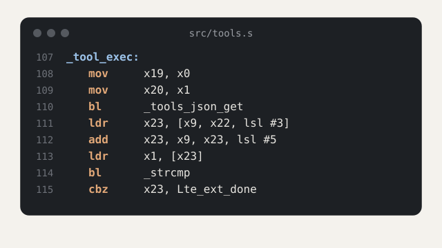
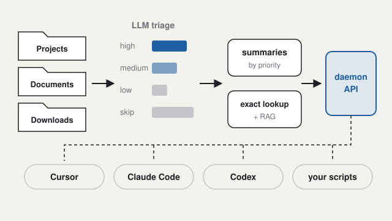
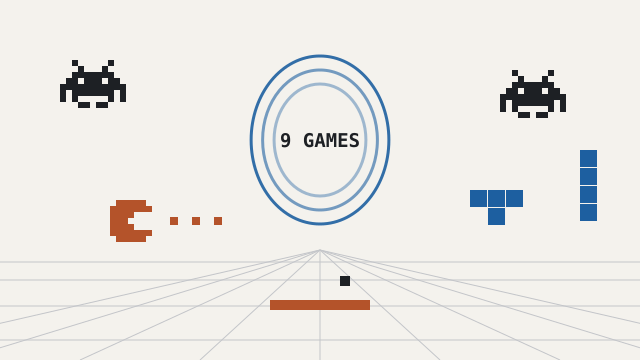
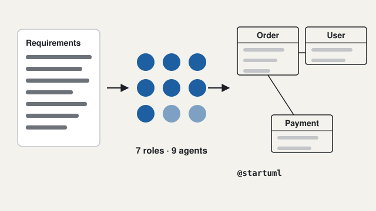

Backend and AI-agent engineer in Hong Kong. MSc Computer Science, HKU (2026).
Portfolio, case studies and resume: **[markfugod.github.io/MarkfuGod-CV](https://markfugod.github.io/MarkfuGod-CV/)**

<table>
<tr>
<td width="50%" valign="top">
 
<b><a href="https://github.com/MarkfuGod/pi-asm">pi-asm</a></b> 
A coding agent written in ARM64 assembly. Runs on macOS and Linux, with a sandboxed multi-user server.
</td>
<td width="50%" valign="top">
 
<b><a href="https://github.com/MarkfuGod/KithAgent">KithAgent</a></b> 
Local memory for AI agents. It indexes folders you choose, has an LLM triage every file, and serves summaries and search to Cursor, Claude Code or your own scripts.
</td>
</tr>
<tr>
<td width="50%" valign="top">
 
<b><a href="https://github.com/MarkfuGod/atari-portal">Atari Portal</a></b> 
Nine arcade games joined by portals. Every sprite and sound is generated at runtime. <a href="https://markfugod.github.io/atari-portal/">Play it in the browser.</a>
</td>
<td width="50%" valign="top">
 
<b><a href="https://github.com/MarkfuGod/NL2BP-Natural-Language-to-UML-Blueprints">NL2BP</a></b> 
My BEng thesis. Nine CrewAI agents in seven roles turn written requirements into PlantUML designs.
</td>
</tr>
</table>

**Lately**

- Built the Go platform for Matchii, a services marketplace: ledgers, idempotent payments, and an agent runtime that survives restarts.
- Working on a WhatsApp assistant for a clinical exercise programme with 500 participants, where every answer has to cite its source.
- Contributed fixes to [HKUDS/Vibe-Trading](https://github.com/HKUDS/Vibe-Trading).

Also here: agent skills for Claude Code, Cursor and Codex ([CourseReviewSkill](https://github.com/MarkfuGod/CourseReviewSkill), [xiang-da](https://github.com/MarkfuGod/xiang-da)) and an [early hand-rehab project](https://github.com/MarkfuGod/Hand-Recovery-And-Fatigue-Relief-Using-Mediapipe) built with MediaPipe.

[Email](mailto:MarkfuGod@outlook.com) · [LinkedIn](https://www.linkedin.com/in/gai-yifan/)
